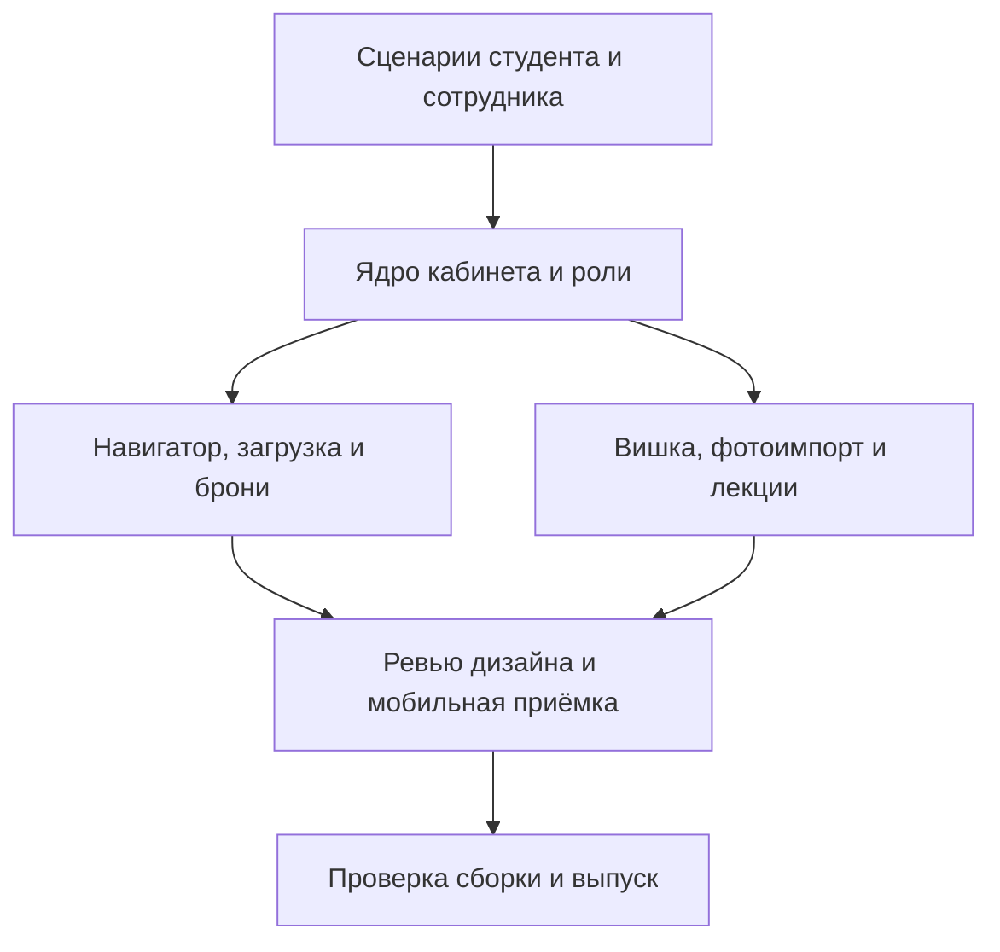

# Цифровой деканат

Веб-кабинет для студентов, преподавателей и сотрудников деканата. Студент видит расписание и изменения, находит аудиторию, работает с лекциями и получает документы. Сотрудник ведёт расписание, заявки и учебные работы. Для установки настраиваются данные вуза, группы и сервисы. На демостенде используются учебные данные.

[Открыть демостенд](https://dekanat.space/login) · [Локальный запуск](#локальный-запуск) · [Сценарии для проверки](#сценарии-для-проверки)

## Ключевые возможности

| Возможность | Что можно сделать |
| --- | --- |
| **Лекции от записи до задания** | Провести эфир для группы или добавить личную лекцию по ссылке либо видеофайлом. После обработки открыть расшифровку, конспект, тест и домашнее задание. В готовой видеотеке можно переключать главы и субтитры, продолжать просмотр с прежнего места и скачивать материалы. |
| **Вишка — помощник по кабинету** | Спросить о парах, оценках или дедлайнах. Помощник учитывает дату и данные текущей роли, указывает на карточку занятия или нужный раздел. Перед созданием задачи можно проверить название и срок и подтвердить действие. |
| **Расписание из фото** | Загрузить JPEG или PNG, сверить распознанные даты, время и аудитории в черновике, исправить строки и подтвердить импорт. Календарь открывает день добавленного занятия. Для обмена доступны CSV и iCalendar. |
| **Поэтажный навигатор** | Найти аудиторию из карточки пары, построить маршрут между этажами и корпусами, затем вернуться к той же неделе расписания. На телефоне схема открывается на весь экран. |
| **Загруженность помещений** | Посмотреть тепловую карту и историю занятости. Для полевого замера можно настроить камеру и линию у входа, считать проходы в обе стороны, сверить результат вручную и выгрузить CSV. |
| **Заявки и справки** | Подать заявку, получить замечание, исправить её и скачать выданный PDF. Сотрудник управляет очередью и статусами. |
| **Учёба и бронирования** | Сдать работу, отслеживать оценку и пересдачу, забронировать помещение или ресурс. В кампусе есть афиша, билеты, справочник и учебный Campus Pay. |

Также доступны личные задачи, заметки, подготовка к занятиям, библиотека, техника, команды, клубы, практики, портфолио, финансы, проживание и поддержка. [Подробный перечень функций](deploy/FEATURES.md)

## Как мы делали проект

Команда сама предложила функции, описала роли и формулировала сценарии до конкретного результата. Мы ревьюили дизайн и архитектуру, самостоятельно дорабатывали детали интерфейса и рефакторили код. В Codex использовали **GPT‑6.2 Astra (Max)** для помощи с реализацией, тестами и исправлениями. Субагентам поручали независимые прогоны и сверку сборки.



## Локальный запуск

Понадобятся macOS или Linux и Python 3.12+. Выполните команду из корня проекта.

```sh
./start-demo.command
```

Откройте `http://127.0.0.1:8098/demo`. Скрипт подготовит учебную SQLite-базу, запустит приложение и выведет данные для входа. Для одновременной проверки ролей откройте `student-a`, `student-b` и `staff` в отдельных профилях браузера. Гостевые страницы доступны без входа.

```sh
# Повторно показать локальные данные для входа
./start-demo.command credentials

# Запустить отдельную демобазу на другом порте
DEAN_DEMO_NAME=jury DEAN_PORT=8101 ./start-demo.command
```

## Сценарии для проверки

1. **От пары до аудитории.** Откройте занятие из недельного расписания, постройте маршрут и вернитесь к той же неделе. Повторите на узком экране.
2. **От заявки до PDF.** Отправьте заявку на справку под студентом, выдайте документ под сотрудником, скачайте его как заявитель. Проверьте доступ из второй студенческой сессии.
3. **Лекция и практика.** В видеотеке откройте «Введение в семантический веб». Переключите главу и субтитры, пройдите тест и скачайте конспект или домашнее задание.
4. **Вопрос Вишке.** Спросите о паре на конкретную дату, откройте её карточку по ссылке и сверяйте аудиторию. Попросите создать задачу и проверьте её до подтверждения.
5. **Бронь и загрузка.** Найдите свободное окно, создайте и отмените бронь. Сравните аудитории на тепловой карте. Для отдельного замера используйте [инструкцию для площадки](FIELD_TRIAL.md).
6. **Расписание с фото.** Загрузите [учебный снимок](samples/weekly-timetable.png), сверьте черновик и проверьте день в календаре после импорта.

## Как проверяли

- **315 Python-тестов и 22 JavaScript-теста** прошли на сборке для GitHub. Серверные сценарии проверяли роли, повтор отправки форм, заявки, PDF, бронь, расписание, лекции и миграции SQLite.
- **Мобильная приёмка.** Проверили интерфейс на 360 и 390 px в браузере. Отдельно прошли переход к маршруту и обратно, вход сотрудника, бронирование и просмотр справки.
- **Запуск из чистой копии.** Развернули архив в отдельной папке, вошли под двумя студентами и сотрудником. Проверили 32 страницы с учётом гостевого режима. `/healthz` вернул `ok`.

```sh
python3 -m unittest discover -s tests -t . -p 'test_*.py'
node --test tests/*.mjs
```

Для проверок ключей доступа установите зависимости из `requirements-auth.txt`. Браузерные сценарии и проверки медиа могут требовать дополнительных системных зависимостей.

## Сервер и интеграции

Демостенд доступен на собственном домене **dekanat.space** по HTTPS. Для серверной установки в репозитории есть Docker Compose, Gunicorn, Caddy и проверка доступности `/healthz`. [Инструкция по развёртыванию](deploy/DEPLOYMENT.md)

Базовое локальное демо запускается с готовыми учебными данными. Для обработки нового фото нужен доступный распознаватель, например Tesseract с русским и английским языками или настроенный провайдер. Для обработки новых записей нужны FFmpeg и модель распознавания речи либо готовая серверная конфигурация. Telegram, внешний вход и внешние модели подключаются отдельно. Campus Pay использует учебный баланс.

## Устройство проекта

| Каталог | Содержимое |
| --- | --- |
| `dean/` | Python-приложение, шаблоны страниц, доменная логика и интерфейс |
| `dean/migrations/` | Версионируемые миграции SQLite |
| `scripts/` | Подготовка демоданных и фоновые задачи |
| `samples/`, `contracts/` | Примеры расписания и форматы обмена |
| `deploy/` | Конфигурация сервера и проверка после установки |
| `tests/` | WSGI- и браузерные сценарии, тесты JavaScript |

[Дополнительные сценарии](START_PRODUCT.md) · [Кампусное демо](START_HERE_CAMPUS.md) · [Сторонние материалы](THIRD_PARTY_NOTICES.md)
